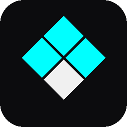
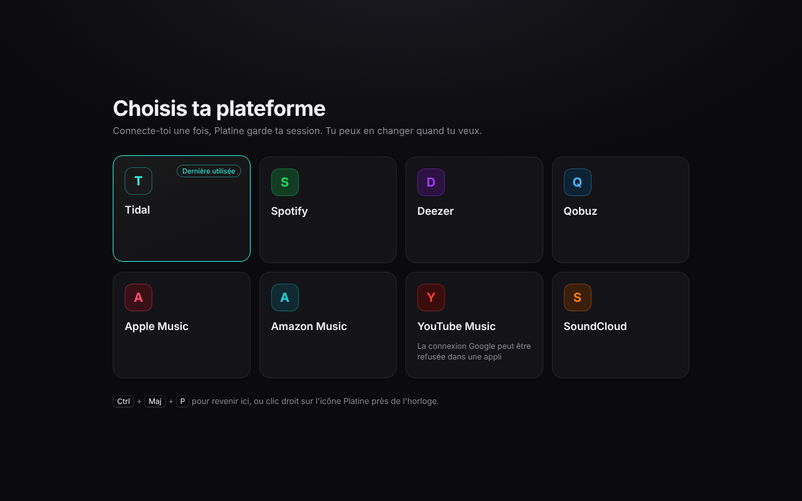
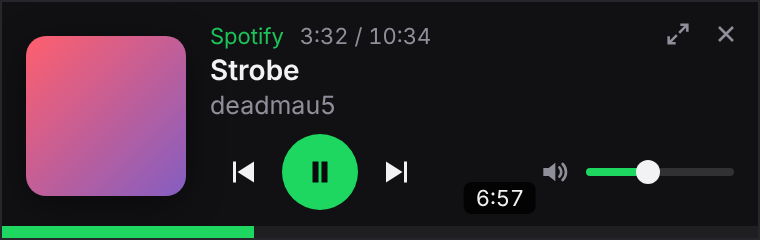
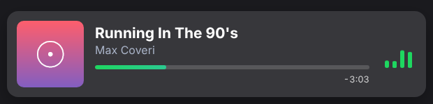

<p align="center">
  
</p>

<h1 align="center">Platine</h1>

<p align="center">
  Toutes tes plateformes de musique dans une seule appli Windows, stable et en qualité maximale.<br>
  Tidal · Spotify · Deezer · Qobuz · Apple Music · Amazon Music · YouTube Music · YouTube · Twitch · SoundCloud
</p>

<p align="center">
  <a href="https://github.com/BlancheLaGoat/platine/releases/latest"><b>⬇ Télécharger la dernière version</b></a>
</p>

<p align="center">
  
</p>

## Pourquoi Platine ?

Les applis desktop officielles plantent, rament ou ne gardent pas la qualité max. Platine fait tourner le **lecteur web officiel** de chaque plateforme dans une appli dédiée, avec le module DRM Widevine : tu gardes ton compte, ta bibliothèque, tes playlists et la qualité **High / Max**. Tout reste synchronisé avec ton téléphone.

## Fonctionnalités

- **Toutes tes plateformes** : choisis-en une au premier lancement, change quand tu veux (`Ctrl + Maj + P`). Une session par plateforme, donc tu restes connecté partout.
- **Mode onglets** (optionnel, menu de l'icône → *Mode onglets*) : plusieurs plateformes ouvertes en même temps (Tidal, Twitch, YouTube…), et **plusieurs onglets YouTube, Twitch ou SoundCloud** (chaque onglet affiche le nom de la vidéo ou de la chaîne ; un lien « ouvrir dans un nouvel onglet » crée un onglet à côté). La musique continue dans les onglets en arrière-plan. Un haut-parleur indique l'onglet qui joue (clic = couper son son). **Glisse un onglet vers le bas** (ou clic droit → *Détacher*) pour l'ouvrir dans sa propre fenêtre, sans recharger la page ; bouton *Rattacher* pour le remettre. Raccourcis : `Ctrl + T` nouvel onglet, `Ctrl + W` fermer, `Ctrl + Tab` onglet suivant, `Ctrl + 1…9`, `Ctrl + Maj + D` détacher. Sans ce mode, Platine fonctionne exactement comme avant.
- **Ne plante plus** : si une page crashe, fige ou que la carte graphique lâche, Platine la relance tout seul, là où tu étais.
- **Mini-lecteur** (`Ctrl + Maj + M`) : petite fenêtre toujours au premier plan, avec pochette, avance dans le morceau et volume.

  

- **Overlay OBS** : une carte « en écoute » pour ton stream, qui se cache toute seule quand la musique est en pause.

  

- **Discord** : affiche « Écoute… » sur ton profil, avec la pochette et le temps restant, quelle que soit la plateforme.
- **Playlists** (`Ctrl + Maj + L`) : toutes tes playlists Tidal et Spotify au même endroit, avec un bouton **Transférer vers…** (une, plusieurs ou toutes d'un coup) et une **sauvegarde** dans un fichier. Les titres sont retrouvés par leur code ISRC, puis par titre / artiste / durée ; un rapport liste ceux qui n'existent pas sur l'autre plateforme. Platine ne supprime jamais rien.
- **YouTube et YouTube Music sans pubs** : quand une pub démarre, Platine coupe le son, la passe en accéléré et clique sur « Passer » ; les bannières et encarts pub sont masqués. Le lecteur n'est jamais modifié, donc rien ne casse. Désactivable dans le menu de l'icône.
- **Twitch sans pubs** : par défaut, Platine utilise le script *vaft* de [TwitchAdSolutions](https://github.com/pixeltris/TwitchAdSolutions) (licence MIT), qui cherche un flux sans pub et retire les segments publicitaires du live. Le projet a été archivé par son auteur en mars 2026 : s'il ne suffit plus, menu de l'icône → *Pubs Twitch* → *Couper le son et masquer* (le son est coupé et l'image cachée pendant la pub). Les encarts pub de la page sont toujours masqués.
- **Touches multimédia** du clavier et contrôles de Windows.
- **Mises à jour automatiques** depuis les Releases GitHub.
- **Lancement au démarrage de Windows**, réduit dans la zone de notification.
- Fermer la fenêtre ne coupe pas la musique : Platine reste près de l'horloge.

Tout se règle par **clic droit sur l'icône Platine** près de l'horloge.

## Installation

1. Télécharge `Platine-Setup-x.y.z.exe` depuis les [Releases](https://github.com/BlancheLaGoat/platine/releases/latest).
2. Lance-le. Si Windows affiche **« Windows a protégé votre ordinateur »**, clique sur **Informations complémentaires** puis **Exécuter quand même**. Ce message apparaît pour toute appli sans certificat Microsoft payant ; le code de Platine est entièrement lisible dans ce repo.
3. Choisis ta plateforme et connecte-toi.

## Overlay OBS

1. Clic droit sur l'icône Platine → **Overlay OBS → Activé**, puis **Copier le lien pour OBS**.
2. Dans OBS : **Sources → + → Navigateur**, colle le lien (`http://127.0.0.1:4848/overlay`), largeur `620`, hauteur `150`.

Options à ajouter à la fin du lien :

| Option | Effet |
| --- | --- |
| `?style=carte` | autre présentation : nom de la plateforme en haut, fine barre en bas |
| `?pause=show` | reste affiché quand la musique est en pause |
| `?compact=1` | version plus petite, sans pochette |
| `?align=right` | colle la carte à droite |
| `?accent=00e5ff` | force une couleur (sinon celle de la plateforme) |

Les options se combinent : `…/overlay?accent=00e5ff&pause=show`. L'état brut est aussi disponible en JSON sur `http://127.0.0.1:4848/now`. Le serveur n'écoute que sur ton PC, rien n'est accessible depuis le réseau.

## Playlists : connecter Tidal et Spotify

Platine passe par les API officielles : il faut une « appli développeur » (gratuite) sur chaque plateforme, une seule fois.

1. **Tidal** : [developer.tidal.com/dashboard](https://developer.tidal.com/dashboard) → crée une appli → dans ses réglages, ajoute l'adresse de redirection `http://127.0.0.1:4849/callback` (et si le portail propose de choisir des droits, coche *playlists*, *collection*, *search* et *user*) → copie le **Client ID**.
2. **Spotify** : [developer.spotify.com/dashboard](https://developer.spotify.com/dashboard) → *Create app* → API : *Web API* → adresse de redirection `http://127.0.0.1:4849/callback` → copie le **Client ID**. Spotify exige que le compte qui crée l'appli ait **Premium**.
3. Colle les deux ID dans `src/config.js` (`TIDAL_CLIENT_ID`, `SPOTIFY_CLIENT_ID`), puis dans Platine : **Playlists → Connecter**. La connexion s'ouvre dans ton navigateur habituel.

Limites connues : Spotify ne donne accès qu'au contenu de **tes** playlists (pas celles que tu suis), et une poignée de titres peuvent manquer d'une plateforme à l'autre (exclusivités, versions régionales) — ils sont listés dans le rapport.

## Questions fréquentes

**La connexion Google est refusée.** Google bloque volontairement sa connexion dans les applis qui embarquent un navigateur. Connecte-toi par e-mail + mot de passe (crée un mot de passe avec « Mot de passe oublié » si besoin). Pour YouTube Music, ça peut rester bloqué.

**Pourquoi plusieurs « Platine » dans le Gestionnaire des tâches ?** Platine est construit sur Chrome, qui sépare l'interface, l'audio, le réseau, le DRM et chaque page dans des processus différents. C'est ce qui lui permet de relancer une page plantée sans tout fermer. Environ 500 Mo de mémoire, c'est normal.

**Une plateforme ne lit rien ou affiche une erreur de lecture.** Recharge (clic droit sur l'icône → Recharger). Si ça continue, ouvre le journal des crashs depuis le même menu et ouvre une *issue* avec son contenu.

---

## Pour les développeurs

```
npm install
python -m castlabs_evs.vmp sign-pkg node_modules/electron/dist
npm start
```

- `npm run dist` construit l'installeur dans `dist/`, signé automatiquement par Castlabs (compte EVS gratuit : `pip install castlabs-evs` puis `python -m castlabs_evs.account signup`).
- **Ajouter une plateforme** : une entrée dans `src/platforms.js` (nom, couleurs, URL du lecteur web, domaines).
- **Discord** : mets l'*Application ID* de ton appli Discord dans `src/config.js`.
- **Playlists** : les connecteurs sont dans `src/connectors/` (un fichier par plateforme + `match.js` pour la correspondance des titres). Les jetons sont chiffrés par Windows (`safeStorage`) dans le dossier de données de Platine.
- **Publier une version** : change `"version"` dans `package.json`, commit, push, puis tag `vX.Y.Z`. Le workflow GitHub Actions (secrets `EVS_ACCOUNT` / `EVS_PASSWD`) construit, signe et publie la Release ; les Platine installés se mettent à jour tout seuls.
- **Mettre à jour Chrome** : change la version Castlabs aux deux endroits de `package.json` (`devDependencies.electron` et `build.electronDownload.version`).

Le blocage des pubs Twitch reprend le script *vaft* de [TwitchAdSolutions](https://github.com/pixeltris/TwitchAdSolutions) (MIT, © TwitchAdSolutions Contributors), copié tel quel dans `src/vendor/`.

Construit avec [Electron for Content Security (Castlabs)](https://github.com/castlabs/electron-releases), [electron-builder](https://www.electron.build/) et [@xhayper/discord-rpc](https://github.com/xhayper/discord-rpc). Platine n'est affilié à aucune des plateformes citées.
